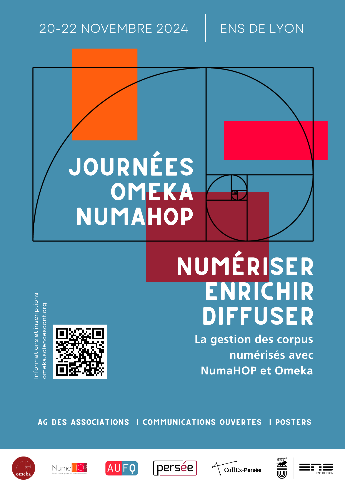

import Icon from '@site/src/components/Icon';

Les journées NumaHOP 2024 ont été organisées conjointement avec l’association des usagers franophones d’Omeka, et ont eu lieu du 20 au 22 novembre à l’ENS de Lyon. Elles ont été l’occasion de faire un point sur les avancées, défis et perspectives de ces deux outils complémentaires pour la gestion des chaînes de numérisation et la valorisation des collections patrimoniales. Voici les temps forts liés à NumaHOP.

<!-- truncate -->

#### Migration historique : l'instance mutualisée NumaHOP chez BibLibre
Un moment clé de ces journées a été le retour d’expérience sur la migration de l’instance mutualisée NumaHOP (Bibliothèque Sainte-Geneviève, Sciences Po, BULAC) vers le prestataire BibLibre, effective depuis septembre 2024.
- Enjeux : Après la fin du contrat avec le développeur historique, les trois établissements ont dû trouver un nouveau prestataire pour assurer l’hébergement et la maintenance.
- Défis : Gestion des enjeux techniques et organisationnels, adaptation à un nouvel écosystème de développement multi-acteurs.
- Perspectives : Ouverture d’un dialogue avec la communauté pour faire évoluer le logiciel dans ce nouveau cadre.

Intervenants : Olesea Dubois (Sciences Po), Laurent Poligny (BSG), Gabriel Raupp (BULAC).

#### NumaHOP et les archives : interopérabilité et nouveautés
Plusieurs sessions ont mis en lumière l’intégration de NumaHOP dans des workflows d’archivage et son interopérabilité avec d’autres outils :
- Présentation du programme Archives de CollEx-Persée (Judith Soria, Muséum national d’histoire naturelle).
- Découverte de Vitam et de sa démarche d’audit (Philippe Prat, CINES).
- Nouveautés dans Calames (Étienne Naddeo, ABES) : Adaptations réalisées grâce aux retours de la communauté NumaHOP.

Objectif : Renforcer les liens entre NumaHOP et les écosystèmes d’archivage pour une gestion fluide des données.

#### Complémentarité avec Omeka : des flux optimisés
Une table ronde a illustré la synergie entre NumaHOP et Omeka à travers trois exemples concrets :
1. Bibliothèque de Sciences Po : Projet *"Le fonds Jean Longuet : don, numérisation, diffusion"*.
2. Bibliothèque de l’ENS : Création de la Bibliothèque numérique de l’ENS.
3. BULAC : Projet EpiPOM (*Épigraphie du Proche-Orient médiéval*), mené par Martina Massullo (chercheuse en résidence en 2021-2022).
   - Cas d’usage : Assemblage et comparaison d’images via le protocole IIIF, avec des transcriptions HTR (Handwritten Text Recognition) intégrées dans Omeka S.

Animation : Hortense Longequeue (Bibliothèque municipale de Lyon).

#### Autres temps forts
- Présentation de l’Ouvroir NumaHOP (Sarah Gauthé, CollEx-Persée) : Un projet ambitieux pour fédérer les pratiques autour de NumaHOP.
- Assemblée Générale de l’association NumaHOP : Moment d’échange pour défini les priorités de développement et de diffusion du logiciel.
- Posters et démonstrations :
  - *Allineamento* : Alignement entre Omeka et IdRef (Laurent Aucher, Pauline Rivière, Agnieszka Halczuk).
  - *Numaclay* : Valorisation des patrimoines scientifiques avec Omeka S (Oriane Boissel, Sylvie Sallé).

### Pourquoi ces journées sont-elles importantes ?
- Partage d’expériences : Retour sur des migrations complexes, des bonnes pratiques et des solutions innovantes.
- Collaboration renforcée : Échanges entre développeurs, bibliothécaires, chercheurs et prestataires pour faire évoluer les outils.
- Ouverture à la communauté : Les journées étaient libres d’accès, favorisant l’inclusion de tous les acteurs (petites équipes, chercheurs individuels, etc.).

<Icon icon={["fa", "external-link"]} /> [Association AUFO](https://aufo.fr)

<Icon icon={["fa", "external-link"]} /> [CollEx-Persée](https://www.collex-persée.fr)

