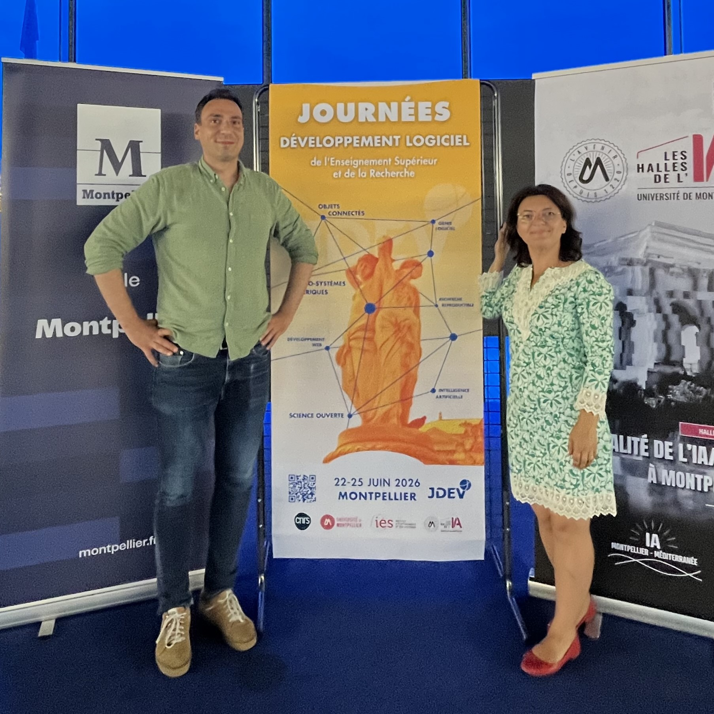

import Icon from '@site/src/components/Icon';

Du 22 au 26 juin 2026, s’est tenue à Montpellier la 12e édition des **Journées du Développement Logiciel** (JDEV), un événement incontournable pour les acteurs du logiciel dans l’**Enseignement Supérieur et la Recherche** (ESR). Olesea DUbois (Sciences Po Paris) et François Gandolfi (Humathèque Condorcet) y ont représenté NumaHOP pour une intervention intitulée :
*De la numérisation à la gestion des contenus numérisés : répondre collectivement aux défis des savoirs scientifiques*.

<Icon icon={["fa", "arrow-up-right-from-square"]} /> [Site officiel des JDEV 2026](https://jdev26.sciencesconf.org/?lang=fr).

<!-- truncate -->

### NumaHOP à l’honneur

Notre session, qui s’est déroulée le mercredi 24 juin, avait pour objectif de présenter les grandes lignes de la naissance et du fonctionnement de NumaHOP, et de recueillir les retours des participants sur les développements futurs du logiciel.

Nous en avons profité pour solliciter des conseils sur les priorités à donner à ces développements. Les retours ont été unanimes : la première priorité doit être celle de la **mise à jour du front-end** (passage de AngularJS à Angular), avant d'envisager la **modernisation du back-end** (SpringBoot).

Nous avons également appris l’existence du [**Catalogue des logiciels libres de la recherche académique**](https://hal.science/). Une fois le dépôt de NumaHOP effectué sur HAL, le logiciel y sera référencé, ce qui renforcera sa visibilité dans l’écosystème de la recherche.

### Un programme riche et varié

Les séances plénières des matinées ont abordé des thèmes centraux pour le développement logiciel dans l’ESR :
- **ILAAS**, une fédération mutualisée pour une IA générative souveraine.
- Les réseaux de l’ESR liés au développement logiciel.
- **LaSuite**, les outils numériques des agents publics.

Les JDEV 2026 ont proposé un programme très dense, avec des interventions courtes (30 minutes à 1 heure max) couvrant un large éventail de sujets. Voici quelques-unes des présentations marquantes auxquelles nous avons pu assisté :
- **Enrichissement des métadonnées d’un logiciel sur un dépôt Git** (LAPP, CNRS).
- Le nouveau **Catalogue des logiciels pour la recherche** (Laboratoire Jean Kuntzmann, Grenoble).
- **TowSty** : Un programme Julia pour générer un site à partir de l’éditeur Stylo (Caen).
- **Flask** : Framework Python pour le développement d’applications (Institut des Sciences de l’Ingénierie et des Systèmes, CNRS).
- **Le Procès de l’IA** : Une conférence interactive dans le cadre du programme FIDLE du CNRS.
- **Contribuer à Debian : Comment le synchrotron SOLEIL relève le défi de la gestion des dépendances scientifiques**.
- **Curation de métadonnées** : Un outil respectant des standards internationaux en sciences sociales (INED).
- **Inférence de LLM et systèmes d’agents** (Institut du Développement et des Ressources en Informatique Scientifique, CNRS).
- **GreenScore Web et Ecofloc** : Mesurer et sensibiliser à l’empreinte carbone et à la consommation énergétique.
- **IA générative et institutions patrimoniales** : Retours d’expérience et adaptations.
- **Licences et gestion des projets logiciels libres** (François Pellegrini, CNRS).
- **Mise en place d’une forge institutionnelle** : Retour d’expérience sur la conception, le déploiement et la gouvernance à l'INRAE.

La majorité des participants et intervenants étaient des développeurs issus des sciences dures, mais quelques interventions concernaient les Sciences Humaines et Sociales (SHS).

### Perspectives et opportunités pour NumaHOP

#### Une visibilité renforcée
Notre intervention a suscité un vif intérêt, notamment de la part de Persée, qui était présent lors de notre présentation. Les développeurs grenoblois nous ont également partagé qu’ils utilisaient des scripts maison pour la numérisation, mais qu’aucun outil ne répondait pleinement à leurs exigences pour les données en sciences dures.

#### Des pistes à explorer
Plusieurs opportunités ont émergé lors de ces journées :
- Financements UNESCO : des financements pourraient être disponibles pour des activités similaires à celles de NumaHOP. Une piste à creuser !
- Collaboration avec l’Institut de l'Information Scientifique et Technique (INIST), qui déploie déjà des solutions Omeka pour les établissements, une collaboration pourrait être envisagée.
- La "souveraineté" : un mot clé dans les appels à projets actuels, à intégrer dans les prochaines candidatures en faveur de NumaHop.

### Conclusion

Les JDEV 2026 ont été une expérience enrichissante pour NumaHOP, avec des retours positifs, des pistes de financement et des opportunités de collaboration. Ces journées ont aussi confirmé l’importance de moderniser notre outil pour répondre aux besoins croissants de la communauté.

