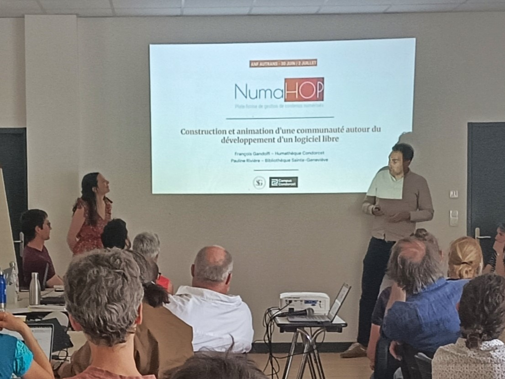

import Icon from '@site/src/components/Icon';

Cette semaine, Pauline Rivière (BSG) et François Gandolfi (Humathèque Condorcet) ont représenté le projet NumaHOP lors de l’Action National de Formation (ANF) organisé par l’**Université Grenoble Alpes** (UGA). Cet événement, dédié à la construction et à l’animation de communautés autour des **logiciels libres**, a permis d’échanger sur des enjeux juridiques, techniques et communautaires, trois dimensions essentielles pour la pérennité des projets *open source*.

<Icon icon={["fa", "arrow-up-right-from-square"]} /> [Site officiel de l'ANF](https://animeopensource.sciencesconf.org/)

<!-- truncate -->

### Les interventions plénières : trois approches complémentaires

L’ANF a été rythmée par trois conférences plénières offrant des perspectives variées sur l’open source :

- <Icon icon={["fa", "people-arrows"]} /> Approche sociologique :
  *Au-delà des mondes antagonistes : les économies enchevêtrées du logiciel libre et de l’industrie informatique*
  Intervenant : Gabriel Alcaras (Sciences Po Paris, MédiaLab).

- <Icon icon={["fa", "gavel"]} /> Approche juridique :
  *La problématique juridique*
  Intervenant : Jérémy Pappalardo, avocat spécialisé en droit de la propriété intellectuelle et de l’innovation.

- <Icon icon={["fa", "wrench"]} /> Approche pratique et technique :
  *La question de la gouvernance*
  Intervenants : Mykaël Vigo (IGE, CNRS) et Antonin Delpeuch (Télécom Paris).

### NumaHOP au cœur des échanges

Pauline et François sont intervenus dans chaque session de la deuxième partie de l’ANF, où ils ont positionné NumaHOP comme un cas d’étude concret à travers les trois prismes abordés :
- <Icon icon={["fa", "gavel"]} /> Juridique : licence, propriété intellectuelle et cadre légal.
- <Icon icon={["fa", "wrench"]} /> Technique : gouvernance du code et organisation du développement.
- <Icon icon={["fa", "users"]} /> Communautaire : animation, collaboration et pérennisation du projet.

Bien que le monde de la documentation ait été peu représenté (à l’exception de collègues bibliothécaires et de l’atelier de la donnée de l’UGA), les retours sur les témoignages de NumaHOP ont été très positifs. L’**historique du projet**, détaillé par Pauline, a particulièrement marqué les participants, offrant une vision claire de son évolution et des défis rencontrés.

### NumaHOP : des atouts à valoriser

Cette participation a permis de mettre en lumière plusieurs forces du projet.

- <Icon icon={["fa", "check"]} /> Une licence adaptée :
le choix de la **licence AGPL** pour NumaHOP s’avère judicieux, car elle autorise une distribution locale ou en SaaS (*Software as a Service*), tout en protégeant le code source.

- <Icon icon={["fa", "check"]} /> Une identité protégée :
la marque et les **noms de domaine** ont été acquis dès l’origine, ce qui renforce la crédibilité et la visibilité du projet.

- <Icon icon={["fa", "check"]} /> Une maturité communautaire :
NumaHOP se distingue par son **modèle associatif** inter-établissements, une approche encore peu répandue dans l’écosystème des logiciels libres académiques, où les projets restent souvent cantonnés à un laboratoire ou un campus.

Cependant, il reste des défis à relever, notamment sur le plan technique, où NumaHOP accuse un certain retard par rapport à d’autres projets.

### Perspectives pour l’association NumaHOP

À l’issue de cette ANF, deux priorités émergent pour l’association. D'une part, l’appropriation technique : il est essentiel que les membres du bureau et la communauté s’approprient le dépôt GitHub et ses fonctionnalités clés (gestion des issues, contributions, etc.).Cela permettrait de faire vivre le projet en synergie avec les prestataires, tout en renforçant l’autonomie de la communauté. D'autre part, la recherche de financements : pour résorber la dette technique et relancer le projet sur des bases solides, la quête de financements reste une priorité.

### Conclusion

Cette ANF a confirmé que NumaHOP dispose d’atouts majeurs pour son avenir, mais aussi de pistes claires pour progresser. Les échanges avec les autres participants ont été riches en enseignements, et les retours positifs sur le projet renforcent sa légitimité dans l’écosystème du logiciel libre.

