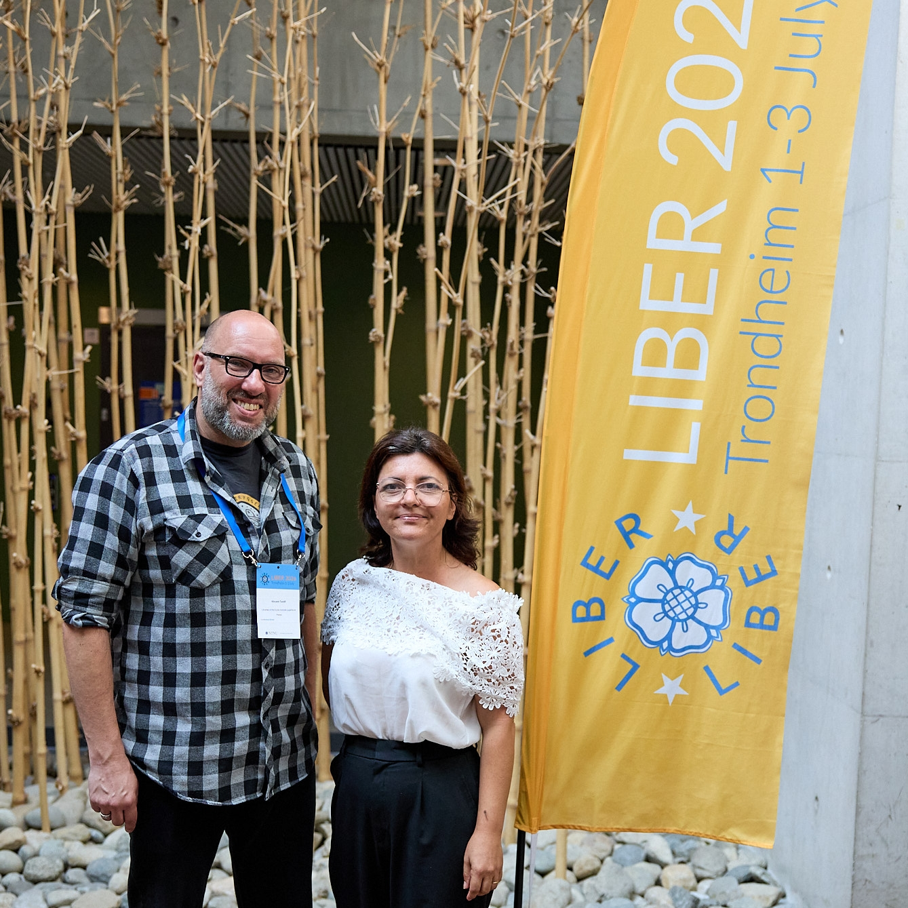

import Icon from '@site/src/components/Icon';

Olesea Dubois (Sciences Po Paris) et Vincent Tardif (ENS paris) ont eu le plaisir de présenter NumaHOP aux Journées LIBER 2026 qui ont réuni une large communauté européenne de bibliothèques de recherche autour des enjeux stratégiques liés aux infrastructures numériques et à la gestion des collections et à la science ouverte. L'édition de cette année à particulièrement mis en avant les outils permettant de renforcer la résilience des bibliothèques face aux évolutions technologiques rapides ainsi que les solutions collaboratives.

L'occasion de revenir sur les évolutions de NumaHOP, sur la dynamique de la communauté d'utilisateurs et sur les perspectives ouvertes par l'association pour les années à venir.

<Icon icon={["fa", "arrow-up-right-from-square"]} /> [Site officiel de LIBER 2026](https://liberconference.eu/).

<!-- truncate -->

