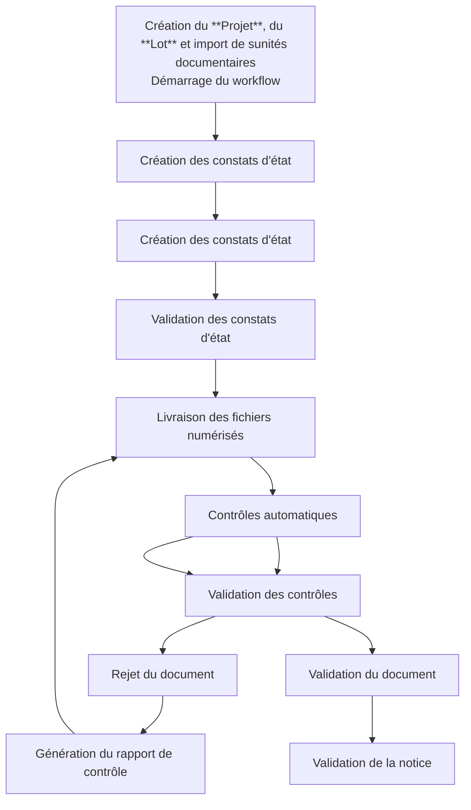

import Icon from '@site/src/components/Icon';

# <Icon icon={["fa", "file-lines"]} />Le contrôle qualité dans le <Icon icon={["fa", "chart-diagram"]} />workflow NumaHOP

Le contrôle qualité intervient après livraison des fichiers par le prestataire. NumaHop effectue d’abord une série de contrôles automatisés en fonction du paramétrage effectué.

Une fois les contrôles automatiques validés, les documents passent en attente de contrôles manuels. Il est alors possible d’appliquer deux niveaux de contrôle :
- Du pré-rejet et de la pré-validation
- Puis une étape de validation définitive des contrôles

Le contrôle qualité dans NumaHop se fait grâce à la visionneuse embarquée. Selon les paramétrages choisis, il peut être :
- Exhaustif (vérification de toutes les pages de tous les documents du lot)
- Effectué par échantillonnage (un nombre de pages limité par document, un nombre de documents limité par lot ou un nombre de pages limité par lot). Le pourcentage d’échantillonnage est également indiqué dans les paramétrages.

# <Icon icon={["fa", "eye"]} /> Configuration des contrôles

:::warning Page en cours de rédaction
:::

Dans Numahop, les contrôles sont paramétrés dans le menu <Icon icon={["fa", "gear"]} />**Administration**, puis dans la section **Contrôles** .

On va ensuite créer des configurations de contrôle types, correspondant à différents types de <Icon icon={["fa", "chart-diagram"]} />**workflows** ou de situation, et qui pourront ensuite être définies au niveau d'un <Icon icon={["fa", "book"]} />**projet**, voire d'un Icon icon={["fa", "boxes-stacked"]} />**lot**. 

