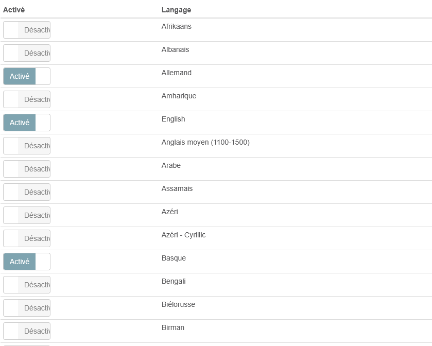

import Icon from '@site/src/components/Icon';

# <Icon icon={["fa", "barcode"]} /> Configuration des langues OCR

La génération de fichiers OCR sur NumaHop est gérée par le logiciel libre Tesseract. 

Ce logiciel supporte par défaut un grand nombre de langues, avec pour chacun des modèles spécifiques de reconnaissance de caractères. 

Selon les langues des documents à numériser, il est possible d'activer un ou plusieurs modèles de langage dans Numahop dans la section **Administration**>**Gestion des langages pour l'OCR**. 

La liste des modèles de langues disponibles est consultable sur https://github.com/tesseract-ocr/tessdata.
