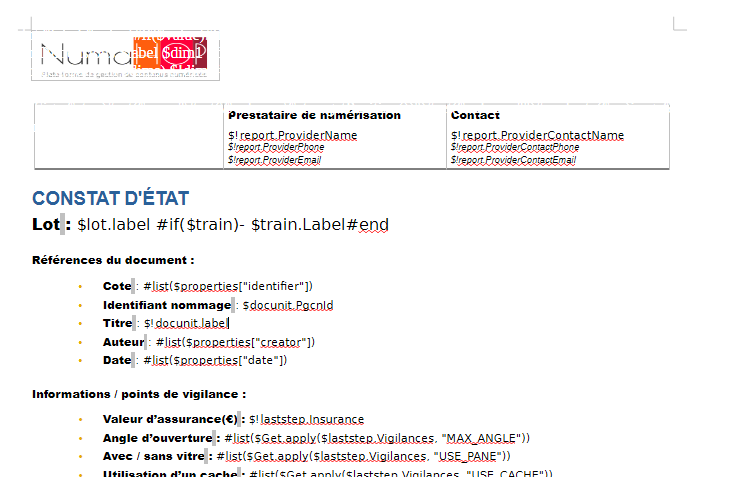

import Icon from '@site/src/components/Icon';

# <Icon icon={["fa", "file"]} /> Configuration des templates

:::warning Page en cours de rédaction
:::

Il est possible de rajouter, sous la forme d'un fichier (.txt ou .odt), des templates pour:
-Des constats d'état
-Des courriels spécifiques (réinitialisation du mot de passe, création d'un utilisateur)

## Exemple de templates

### Email création nouvel utilisateur 

_SUBJECT_NumaHOP : Création de votre compte
_BODY_Bonjour,

Votre compte vient d'être créé.

Vous pouvez désormais vous connecter à l'aide de :
	* votre identifiant  : $login 
	* votre mot de passe : $password (vous pouvez le modifier)

Merci d'utiliser NumaHOP,
NumaHOP, plateforme de gestion de contenus numérisés.

Rejoignez sa communauté d'utilisateurs : https://www.numahop.fr/

### Email réinitialisation de mot de passe 

_SUBJECT_NumaHOP : Réinitialisation mot de passe
_BODY_Bonjour,

Nous avons pris en compte votre demande de réinitialisation de mot de passe.

Vous pouvez désormais vous connecter à l'aide de :
	* votre identifiant  : $login 
	* votre mot de passe : $password

Merci d'utiliser NumaHOP,
NumaHOP, plateforme de gestion de contenus numérisés.

Rejoignez sa communauté d'utilisateurs : https://www.numahop.fr/

### 

